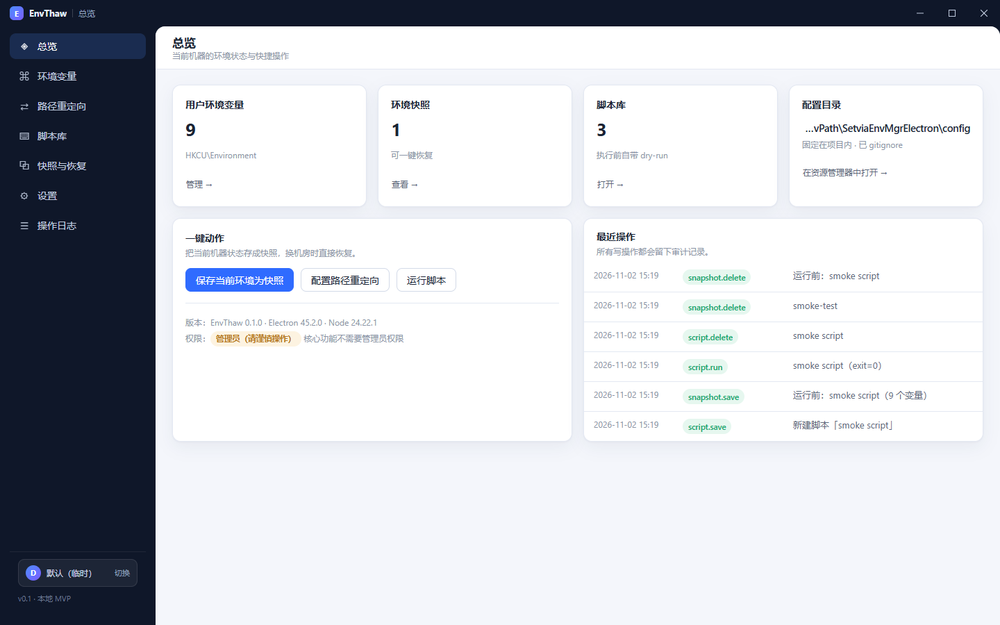
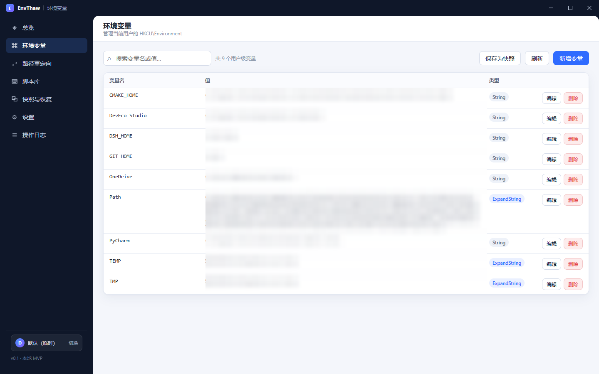
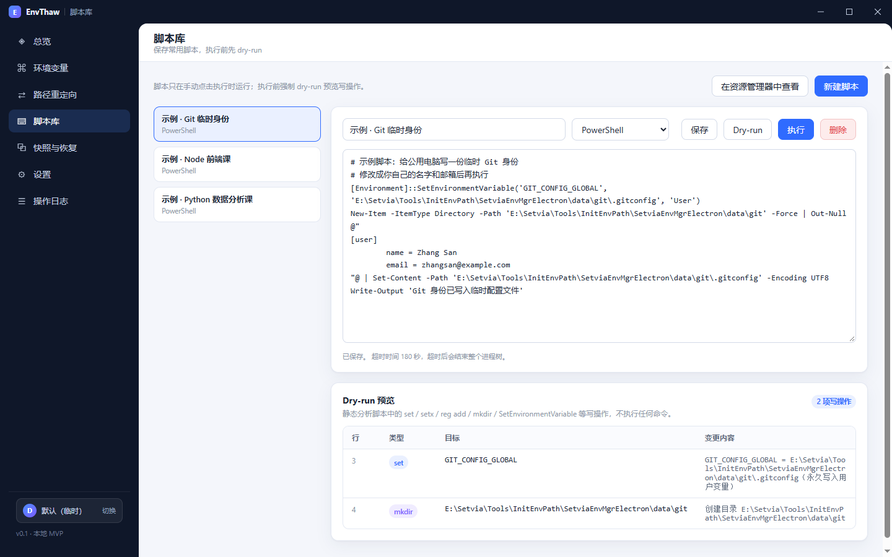
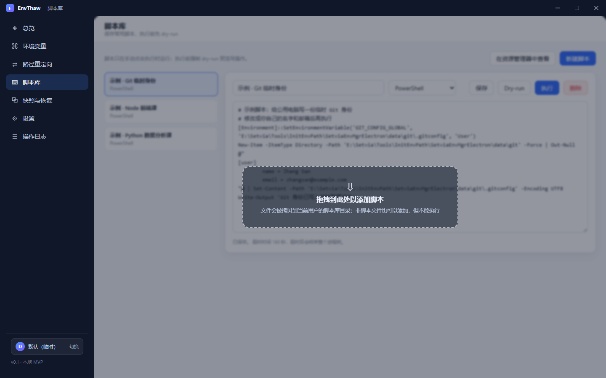
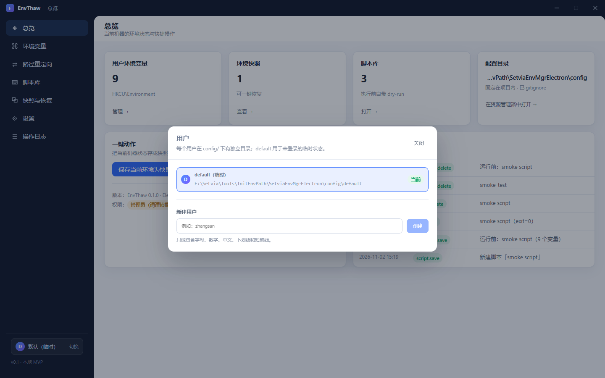
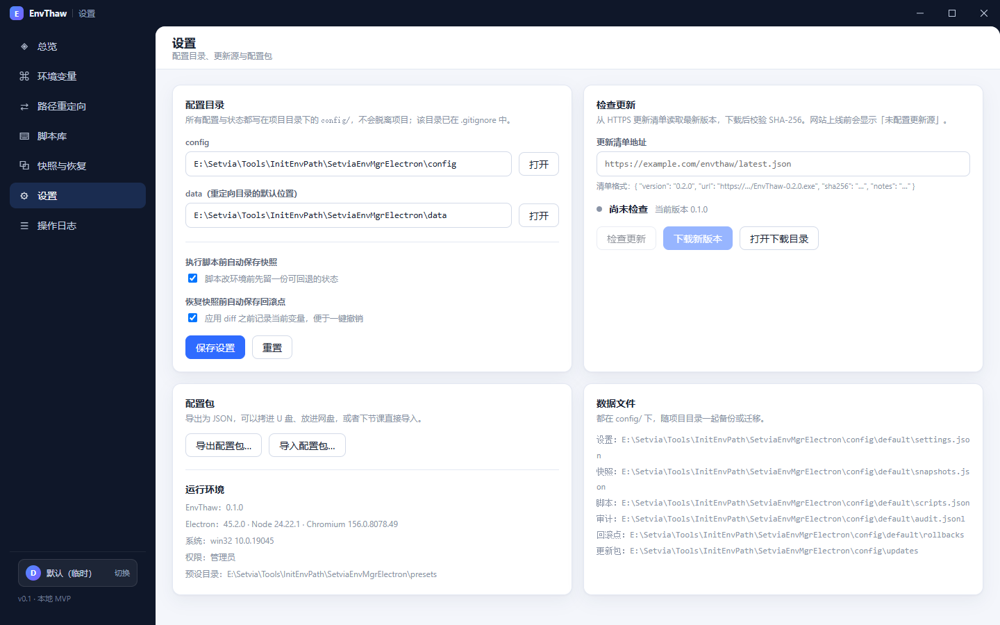
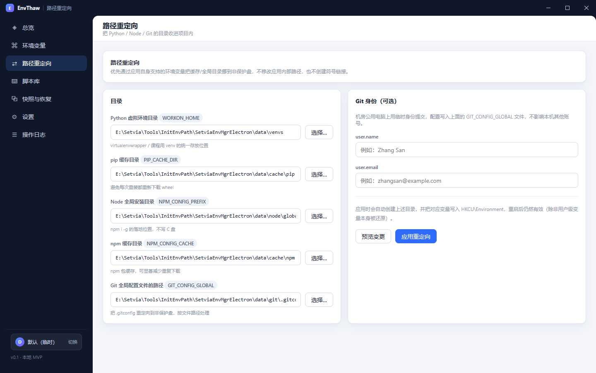

# EnvThaw · 环境管理器

面向学生开发者的、**冰点还原环境下的可持久化开发工作区编排工具**。
把公共机房电脑变成自己熟悉的开发环境，重启后重新登录即可恢复。

> 实现自《环境管理器（EnvMgr）开发文档（草案）》v0.1 的本地 MVP（P0 + 部分 P1）。
> 仓库：<https://github.com/Setvia/envthaw>



## 功能

| 模块 | 状态 | 说明 |
| --- | --- | --- |
| 多用户 | ✅ | 每个用户在 `config/<user>/` 下有独立目录，`default` 为未登录的临时状态；可创建 / 切换 / 删除 |
| 环境变量管理 | ✅ | 读取 / 搜索 / 新增 / 修改 / 删除 `HKCU\Environment`，保留 `REG_EXPAND_SZ` 语义，写入后广播 `WM_SETTINGCHANGE` |
| 快照与恢复 | ✅ | 保存用户级变量快照；恢复前展示 diff，只改差异项；每次变更自动生成回滚点，可一键撤销 |
| 路径重定向 | ✅ | `WORKON_HOME` / `PIP_CACHE_DIR` / `NPM_CONFIG_PREFIX` / `NPM_CONFIG_CACHE` / `GIT_CONFIG_GLOBAL`，默认收进项目内 `data/` |
| 脚本库 | ✅ | 脚本以**文件**形式存放在 `<user>/scripts/`；支持拖拽添加（复制入库）、在资源管理器中打开、dry-run、执行与超时控制 |
| 配置包 | ✅ | 导出 / 导入 JSON（设置、重定向、快照、脚本） |
| 检查更新 | ✅ | 读取 HTTPS 更新清单 → 对比版本 → 下载安装包（进度条 + SHA-256 校验）→ 打开下载目录 |
| 审计日志 | ✅ | 所有写操作落 `audit.jsonl`，UI 可查，按用户隔离 |
| 无边框窗口 | ✅ | 自绘标题栏（拖动 / 双击最大化 / 最小化 / 最大化 / 关闭），布局参考 DSH 桌面端 |
| 内嵌命令行 | ⬜ | 文档中为 P1，本期未实现 |
| 云同步 / 账号 | ⬜ | 文档中为付费能力（M6+），本期未实现 |
| Agent 辅助 | ⬜ | 文档中为付费能力（M8），本期未实现 |

### 界面

| 环境变量 | 脚本 + dry-run |
| --- | --- |
|  |  |

| 拖拽添加脚本 | 用户切换 |
| --- | --- |
|  |  |

| 设置 / 检查更新 | 路径重定向 |
| --- | --- |
|  |  |

## 技术栈

- **electron-vite 6 + Vite 8 + TypeScript 7 + React 19**
- 主进程只使用 Node 内置模块（`fs` / `child_process` / `fetch`），注册表读写走 PowerShell（无需 native 依赖）
- 参数校验：`zod`（`src/shared/config-schema.ts`）
- 打包：`electron-builder`（portable target，`presets/` 通过 `extraResources` 一起打包）

## 目录结构

```
presets/                     # 随仓库分发的示例与模板（播种到每个新用户目录）
├── scripts.json             # 示例脚本
├── script-templates.json    # “新建脚本”的模板
└── redirect.json            # 路径重定向默认值

config/                      # 运行时配置（gitignore）
├── session.json             # 当前用户
├── updates/                 # 更新包下载目录（与环境无关，共用）
└── <user>/                  # 每个用户一份
    ├── settings.json
    ├── snapshots.json
    ├── scripts.json         # 只存元数据，内容在 scripts/ 里
    ├── scripts/             # 脚本文件本体（拖拽添加时复制到这里）
    ├── redirect.json
    ├── audit.jsonl
    └── rollbacks/

data/                        # 重定向指向的工作数据（venv / 缓存），gitignore

src/
├── main/
│   ├── index.ts             # 入口、无边框窗口、生命周期
│   ├── ipc/                 # env / script / path / transfer / app / audit / users / window / update
│   ├── services/
│   │   ├── paths.ts            # 项目根 / config / 用户目录 / data / presets
│   │   ├── env-service.ts      # 变量读写 + 快照 + 回滚
│   │   ├── restore-engine.ts   # 纯 diff / 逆向 diff
│   │   ├── script-runner.ts    # dry-run 解析 + 执行 + 文件导入
│   │   ├── path-redirect.ts    # 重定向配置与落地
│   │   ├── update-service.ts   # 检查更新 / 下载 / 校验
│   │   └── storage.ts          # 用户目录、播种、脚本文件、审计
│   └── utils/               # powershell / registry
├── preload/                 # contextBridge：window.envthaw
├── renderer/                # React 界面（自绘 TitleBar、UserSwitcher、拖拽区）
└── shared/                  # IPC 类型与 zod schema（唯一真相源）
```

## 开发

```bash
npm install
npm run dev      # electron-vite dev（HMR）
npm start        # 构建后以生产模式启动
npm run build    # 只构建
npm run typecheck
```

### Windows 启动器说明（`scripts/launch.js`）

这台机器上踩到的三个坑，启动器里都做了处理，不必手动干预：

1. **`ELECTRON_RUN_AS_NODE` / `NODE_OPTIONS`** —— 由 IDE 调试终端或 npm 钩子注入，会让 `electron.exe` 变成纯 Node（`require('electron')` 返回字符串），或者预加载调试 bootloader 吞掉主进程日志。启动器对子进程删除这两个变量。
2. **Chromium 沙箱在特定目录下无法初始化** —— 浏览器进程会在 `app.whenReady()` 之前崩溃（`0xC0000005` / `0x80000003`）。首次启动会把 electron 运行时镜像到 `%LOCALAPPDATA%\EnvThaw\runtime\<version>`，再用目录联接接回 `node_modules/electron/dist`。想跳过：`ENVTHAW_LOCAL_RUNTIME=1 npm run dev`。
3. **兜底**：沙箱仍起不来时会用 `--no-sandbox` 重试一次；此时进程是 Low 完整性级别，只能读环境变量。

## 配置文件与多用户

- 配置目录固定为项目内 `config/`，**不可修改、不会写到项目外**；`data/` 放重定向指向的 venv / 缓存。
- `config/session.json` 记录当前用户；每个用户是 `config/<user>/` 一个目录，`default` 是未登录的临时用户。
- 切换用户后界面会整体重载，避免上一份配置残留。
- 新建用户时按 `presets/` 播种示例脚本、模板与重定向默认值；只写缺失文件，删掉示例后不会被重新生成。
- v0.1 的旧版扁平配置会在首次启动时自动迁移进 `config/default/`，旧 JSON 里的脚本文本会被拆成真实文件。
- Chromium profile 在开发模式下放项目内 `.electron-profile/`，打包后使用默认 `%APPDATA%`。

## 脚本库

- 脚本**不是路径引用**：无论拖拽还是新建，内容都会复制进 `config/<user>/scripts/`，源文件移动/删除不影响脚本库。
- 拖拽到脚本页会显示「拖拽到此处以添加脚本」；支持多文件。`.bat` / `.cmd` / `.ps1` 归一为可执行类型，其它后缀也会拷贝入库并给出告警，**运行时会明确报错而不是静默失败**。
- 「在资源管理器中查看」直接打开当前用户的脚本目录。
- 执行前强制 dry-run 预览，执行前自动快照，超时 180s 结束整个进程树。

## 检查更新

`设置 → 检查更新` 填入更新清单地址（HTTPS；本地联调可用 `http://127.0.0.1`），清单格式：

```json
{
  "version": "0.2.0",
  "url": "https://example.com/envthaw/EnvThaw-0.2.0.exe",
  "sha256": "可选的 64 位十六进制摘要",
  "size": 12345678,
  "notes": "更新说明，支持多行",
  "publishedAt": 1762000000000
}
```

- 只接受 https（或本机回环）；下载体积上限 500MB
- 流式写入 `config/updates/`，边下边算 SHA-256，摘要不符会删除半成品
- 下载完成后只提示文件位置，**不会自动运行安装包**

## 安全设计

- `nodeIntegration: false`、`contextIsolation: true`、`sandbox: true`、`webviewTag: false`
- 渲染进程只能通过 `window.envthaw` 调用 IPC；**每个 handler 都用 zod 校验参数**
- 禁止新窗口与外部导航（`setWindowOpenHandler` 拒绝 + `will-navigate` 拦截）
- 只操作 `HKCU\Environment`，**从不触碰系统级变量**（HKLM）
- 脚本不会自动执行；dry-run 预览 → 用户确认 → 执行 → 自动快照 + 审计
- 路径重定向只新增/修改自己的变量，**绝不删除**其它用户变量
- 拖拽导入只接受普通文件，限制 5MB，文件被复制进用户目录而不是引用原路径
- 更新包必须来自 https，校验 SHA-256，绝不自动执行

## 测试

应用启动后可以跑基于 DevTools 协议的冒烟测试（需要调试端口）：

```bash
# 启动时打开调试端口
set ENVTHAW_DEBUG_PORT=9223 && npm start

npm run smoke            # 只读：桥、窗口控制、用户目录、模板、脚本文件化、更新状态
npm run smoke:functional # 写路径：注册表写入（中文值）、快照 diff/恢复/回滚、dry-run、执行
npm run smoke:update     # 更新流程：本地 http 清单 → 检查 → 下载 → SHA-256 → 坏摘要拒绝
npm run smoke:users      # 多用户：创建/切换/删除、脚本导入拷贝、非脚本告警、不可执行报错
```

实测结果：只读 21/21、功能 13/13、更新 9/9、多用户 16/16 通过（Windows 10 22H2，Electron 45.2.0）。

## 已知限制

- 云同步、账号、课程模板市场、Agent 辅助均未实现（文档中的付费/后置能力）
- 内嵌命令行未实现
- 更新站点尚未上线，`updateFeedUrl` 默认为空，界面显示「未配置更新源」
- 用户切换会整体重载界面（简单可靠，但不是无刷新切换）
- 系统级环境变量仅做只读展示，修改需要管理员权限，按文档要求不做
- `--no-sandbox` 兜底模式下无法写环境变量（Windows 完整性级别限制）
- `npm run package` 需要先安装 `electron-builder`（未随依赖安装）

## License

Business Source License 1.1（见 [LICENSE](LICENSE)）：客户端代码禁止用于提供竞争性托管/管理服务，
Change Date 2030-11-02 之后自动转为 Apache License 2.0。
